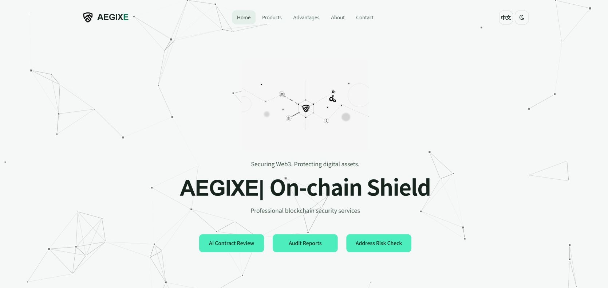

# Aegixe | AI-Powered Web3 Security and On-chain Risk Intelligence

[中文](README.zh-CN.md)

**Aegixe** is a technology services provider specializing in Web3 and blockchain security. We combine AI-assisted detection, expert security review, and on-chain risk intelligence to help Web3 projects, wallets, and digital asset users identify security risks.

Our services include smart contract security audits, AI contract scanning, penetration testing, security incident response, and USDT address risk checks, covering code security, application security, and on-chain fund risk assessment.

🌐 Website: [https://aegixe.com](https://aegixe.com)

---

## Core Security Services

### 1. AI Smart Contract Scanner

Our AI-assisted analysis provides automated smart contract security checks to help developers identify potential security issues during deployment and ongoing operations.

Key capabilities:

- Smart contract code security scanning
- Potential vulnerability detection
- Contract risk analysis
- Security scan reports

Try the tool: [Aegixe Token Security Scanner](https://token-security.aegixe.com/)

### 2. Smart Contract Audit

We combine automated checks with manual review by security experts to provide systematic smart contract security assessments.

Audit activities include:

- Reviewing contract logic and access controls
- Analyzing common smart contract vulnerabilities
- Assessing business logic and fund security risks
- Validating vulnerabilities and assessing severity
- Providing remediation recommendations

By combining AI-assisted scanning with expert validation, we help project teams identify and address potential security issues in their contracts.

### 3. Penetration Testing

We test Web3 applications and related infrastructure to assess potential attack surfaces and security risks.

The scope of each engagement is determined by the project's authorization and agreed testing boundaries.

### 4. 24/7 Security Incident Response

We provide round-the-clock security incident response support for Web3 projects.

Key services:

- Security incident analysis
- Attack path investigation
- On-chain transaction and fund flow analysis
- Security risk assessment
- Incident containment and remediation recommendations

---

## On-chain Risk Intelligence

### 5. USDT Risk Address Checker

Aegixe provides USDT address risk checks to help users identify potential risks before making on-chain transfers or interacting with digital assets.

Core capabilities:

- USDT address risk screening
- Screening for potentially illicit USDT exposure
- Address risk information lookup
- Risk screening API integration

Available through:

- A free Telegram risk screening bot
- An on-chain risk screening API
- Integration partnerships with wallets and Web3 applications

Try the tool: [Aegixe Address Risk Check](https://risk.aegixe.com/)

**API partnerships are available for wallet, trading platform, and DApp development teams.**

For API details, integration methods, or business enquiries, please contact Aegixe through our official channels.

> Risk screening results are provided for reference and do not guarantee safety. On-chain risks change over time, and screening results cannot replace your own risk assessment.

---

## Technology and Service Features

### AI-Assisted Security Analysis

We use AI-assisted security checks to improve the efficiency of code analysis and risk identification.

### Expert Manual Validation

Our security experts further analyze and validate issues identified through automated checks.

### On-chain Risk Intelligence

We provide on-chain address risk checks and related risk intelligence services.

### End-to-end Security Support

Our services span smart contract audits, application security testing, on-chain risk assessment, and security incident response.

---

## Partnerships and Integrations

Aegixe welcomes technical and business collaboration with Web3 projects, wallets, trading platforms, and ecosystem partners.

**Areas of collaboration:**

| Partnership Type | Scope |
| --- | --- |
| Wallet Integration | Integration of USDT address risk screening |
| API Partnership | On-chain risk screening API collaboration |
| Security Audit | Smart contract security audits |
| Security Partnership | Web3 security technology collaboration |
| Ecosystem Partnership | Ecosystem security services and joint promotion |

For API integration, technical documentation, or partnership proposals, please contact our official team.

---

## Official Channels

| Channel | URL |
| --- | --- |
| Official Website | [https://aegixe.com](https://aegixe.com) |
| Chinese X | [https://x.com/aegixe_cn](https://x.com/aegixe_cn) |
| English X | [https://x.com/aegixe_lab](https://x.com/aegixe_lab) |
| Telegram | [https://t.me/Aegixe_cn](https://t.me/Aegixe_cn) |
| Smart Contract Scanner | [https://token-security.aegixe.com/](https://token-security.aegixe.com/) |

---

## About This Repository

This repository collects and shares Web3 security resources, technical documentation, and security research materials related to Aegixe.

Through openly shared security knowledge and technical exchange, we aim to help Web3 developers, project teams, and digital asset users better understand blockchain security risks.

**Aegixe — Building a Safer Web3 Ecosystem.**

---

## Tool guides

| Product | Online tool | English guide | 中文 |
| --- | --- | --- | --- |
| AI smart contract review | [Open](https://token-security.aegixe.com/) | [Guide](guides/token-scan-results.md) | [操作指南](guides/token-scan-results.zh-CN.md) |
| Audit report lookup | [Open](https://aegixe.com/ai_edit_query_new/) | [Guide](guides/audit-report-lookup.md) | [操作指南](guides/audit-report-lookup.zh-CN.md) |
| Address risk detection | [Open](https://risk.aegixe.com/) | [Guide](guides/wallet-address-risk.md) | [操作指南](guides/wallet-address-risk.zh-CN.md) |

The guides were checked against the Chinese web interfaces on 12 November 2026. They cover query steps, result fields and error handling. Check the live interfaces for current features and coverage.

## Security references

- [USDT payment risk and address screening](guides/usdt-payment-risk.md) · [中文](guides/usdt-payment-risk.zh-CN.md)
- [Audit report reading checklist](guides/audit-report-checklist.md) · [中文](guides/audit-report-checklist.zh-CN.md)
- [Telegram query reference](guides/telegram-bot-guide.md) · [中文](guides/telegram-bot-guide.zh-CN.md): historical instructions; current workflow not reverified.

## Appendix and contact

- [Optional record templates](templates/README.md): examples for your own records, not a product, API or formal audit document.
- [Tools and official channels](resources.md) · [Sources and scope](SOURCES.md) · [Documentation corrections](CONTRIBUTING.md)
- [Website](https://aegixe.com/) · [Security service enquiries](https://aegixe.com/contact-us-form/)

This repository provides documentation and reference materials. Automated checks do not replace a full manual audit. Risk signals establish neither wrongdoing nor guaranteed fund safety; missing data, timeouts and unsupported checks remain unknown. Audit conclusions apply to their stated scope and version. Keep client materials, private payment records, credentials and non-public vulnerabilities out of this public repository.
