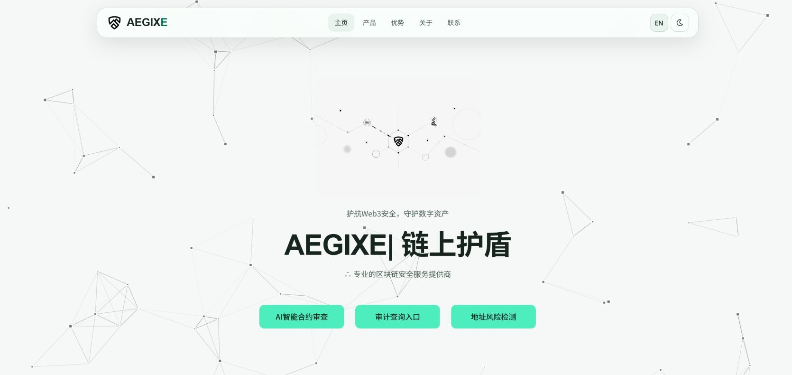

# Aegixe｜AI 驱动的 Web3 安全与链上风险情报

[English](README.md)

**Aegixe** 是一家专注于 Web3 与区块链安全的技术服务提供商，致力于通过 AI 辅助检测、安全专家审核及链上风险情报分析，帮助 Web3 项目、钱包和数字资产用户识别安全风险。

我们提供智能合约安全审计、AI 合约扫描、渗透测试、安全应急响应，以及 USDT 风险地址查询等服务，覆盖代码安全、应用安全和链上资金风险识别等场景。

🌐 官网：[https://aegixe.com](https://aegixe.com)

---

## 核心安全服务

### 1. AI 智能合约安全扫描（AI Smart Contract Scanner）

通过 AI 辅助分析技术，对智能合约进行自动化安全检测，帮助开发者在部署和运营过程中发现潜在安全问题。

主要能力：

- 智能合约代码安全扫描
- 潜在漏洞识别
- 合约风险分析
- 安全检测结果报告

产品入口：[Aegixe Token Security Scanner](https://token-security.aegixe.com/)

### 2. 智能合约安全审计（Smart Contract Audit）

结合自动化检测与安全专家人工审核，对智能合约进行系统性安全评估。

审计工作包括：

- 合约逻辑与权限控制检查
- 常见智能合约漏洞分析
- 业务逻辑与资金安全风险评估
- 漏洞验证与风险等级评估
- 安全修复建议

AI 辅助扫描与人工安全验证相结合，帮助项目团队发现并处理合约中的潜在安全问题。

### 3. 渗透测试（Penetration Testing）

针对 Web3 项目的应用及相关基础设施开展安全测试，评估系统可能面临的攻击面和安全风险。

服务范围根据项目授权及具体测试范围确定。

### 4. 安全应急响应（24/7 Security Incident Response）

为 Web3 项目提供 7×24 安全应急响应支持。

主要服务：

- 安全事件分析
- 攻击路径调查
- 链上交易与资金流向分析
- 安全风险评估
- 事件处置与修复建议

---

## 链上风险情报（On-chain Risk Intelligence）

### 5. USDT 风险地址查询（USDT Risk Address Checker）

Aegixe 提供 USDT 风险地址查询服务，帮助用户在进行链上转账及资产交互前识别潜在风险。

核心功能：

- USDT 风险地址查询
- 黑 U 风险识别
- 地址风险信息查询
- 风险检测 API 接入

产品形式：

- 免费 Telegram 风险查询机器人
- 链上风险查询 API
- 钱包及 Web3 应用集成合作

产品入口：[Aegixe Address Risk Check](https://risk.aegixe.com/)

**面向钱包、交易平台及 DApp 开发团队开放 API 合作。**

如需了解 API 接口、调用方式及商务合作，请通过官方渠道联系 Aegixe。

> 风险检测结果仅作为安全参考，不构成绝对安全保证。链上风险具有动态性，检测结果不能替代用户自身的风险判断。

---

## 技术与服务特点

### AI-Assisted Security Analysis

利用 AI 辅助安全检测，提高代码分析与风险识别效率。

### Expert Manual Validation

结合安全专家人工审核，对自动化检测发现的问题进行进一步分析和验证。

### On-chain Risk Intelligence

提供链上地址风险查询及相关风险情报服务。

### End-to-end Security Support

覆盖智能合约审计、应用安全测试、链上风险识别及安全事件响应等服务场景。

---

## 合作与集成

Aegixe 欢迎 Web3 项目、钱包、交易平台及生态合作伙伴开展技术与商务合作。

**合作方向：**

| 合作类型 | 合作内容 |
| --- | --- |
| Wallet Integration | 集成 USDT 风险地址查询能力 |
| API Partnership | 链上风险检测 API 合作 |
| Security Audit | 智能合约安全审计 |
| Security Partnership | Web3 安全技术合作 |
| Ecosystem Partnership | 生态安全服务与联合推广 |

如需 API 接入、技术文档或合作方案，请联系官方团队。

---

## 官方渠道

| 渠道 | 地址 |
| --- | --- |
| Official Website | [https://aegixe.com](https://aegixe.com) |
| Chinese X | [https://x.com/aegixe_cn](https://x.com/aegixe_cn) |
| English X | [https://x.com/aegixe_lab](https://x.com/aegixe_lab) |
| Telegram | [https://t.me/Aegixe_cn](https://t.me/Aegixe_cn) |
| Smart Contract Scanner | [https://token-security.aegixe.com/](https://token-security.aegixe.com/) |

---

## 关于本仓库

本仓库用于整理和分享 Aegixe 相关的 Web3 安全资源、技术资料及安全研究内容。

我们希望通过开放的安全知识与技术交流，帮助 Web3 开发者、项目团队和数字资产用户更好地理解区块链安全风险。

**Aegixe — Building a Safer Web3 Ecosystem.**

---

## 工具操作指南

| 产品 | 在线使用 | 中文教程 | English |
| --- | --- | --- | --- |
| AI 智能合约审查 | [打开工具](https://token-security.aegixe.com/) | [操作指南](guides/token-scan-results.zh-CN.md) | [Guide](guides/token-scan-results.md) |
| 审计报告查询 | [打开工具](https://aegixe.com/ai_edit_query_new/) | [操作指南](guides/audit-report-lookup.zh-CN.md) | [Guide](guides/audit-report-lookup.md) |
| 地址风险检测 | [打开工具](https://risk.aegixe.com/) | [操作指南](guides/wallet-address-risk.zh-CN.md) | [Guide](guides/wallet-address-risk.md) |

教程依据 2026-11-12 中文网页操作核对，包含查询步骤、字段阅读及异常处理。当前功能与支持范围以在线界面为准。

## 安全参考

- [查黑 U 与 USDT 收款风险](guides/usdt-payment-risk.zh-CN.md) · [English](guides/usdt-payment-risk.md)
- [审计报告阅读与核查清单](guides/audit-report-checklist.zh-CN.md) · [English](guides/audit-report-checklist.md)
- [Telegram 查询参考](guides/telegram-bot-guide.zh-CN.md) · [English](guides/telegram-bot-guide.md)：历史操作参考，当前流程尚未复验。

## 附录与联系

- [可选核查记录模板](templates/README.md)：供自行记录使用，不是产品、API 或正式审计文件。
- [工具与官方渠道](resources.md) · [资料来源与适用范围](SOURCES.md) · [文档纠错](CONTRIBUTING.md)
- [官网](https://aegixe.com/) · [安全服务咨询](https://aegixe.com/contact-us-form/)

本仓库提供文档与参考资料。自动检测不能替代完整人工审计，风险信号不等于违法认定或资金安全保证；缺失、超时与未覆盖信息应保持未知。审计结论只适用于其范围及版本。请勿在公开仓库提交客户资料、私人支付记录、凭据或未公开漏洞。
