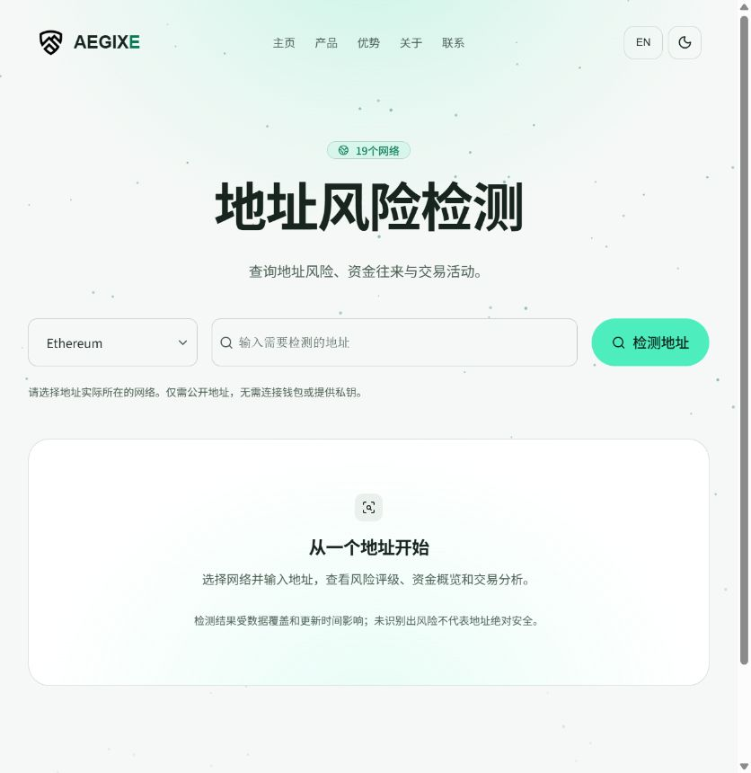

# Address Risk Detection Guide

[中文](wallet-address-risk.zh-CN.md) · [Open tool](https://risk.aegixe.com/) · [Index](../README.md)

Scope: the Chinese AEGIXE address risk web interface. Workflow checked on 12 November 2026. Chinese labels below identify the controls in that interface.

## 1. Prepare the address and network

Use the full public address and confirm its network. A payment wallet, token contract and shared exchange address are different objects. The checker requires a public address, without a wallet connection or private key.

## 2. Run a check

1. Open the tool and select the actual network under “区块链网络”. The interface currently states 19 networks; use the current list. This does not establish equal data coverage across networks.
2. Paste the full address into “钱包地址”. Check all characters and remove unwanted spaces.
3. Click “检测地址”. Wait while “正在检测…” is shown; avoid duplicate submissions.
4. After “地址检测结果已更新”, verify the network, full address and detection time before interpreting results. The Chinese interface labels times as Beijing time.

## 3. Read each module

| Module | How to read it |
| --- | --- |
| Risk summary / 风险摘要 | Read the level, original level, score and address labels together. Do not invent score thresholds or treat a score as a probability of wrongdoing. |
| Balance, transaction count, total inflows/outflows | Check the value, retrieval status and data time. Missing does not mean zero. |
| Risk sources and exposure / 风险来源与暴露明细 | The chart shows a subset of supplied monetary entries. Click “展开明细（count）” for entity, risk type, exposure type, hops, USD amount and share. Sort available columns and page through entries where applicable. |
| Transaction behavior | Compare categories and incoming/outgoing activity; absent counts are not zero. |
| Main counterparties | Identified entities only, rather than a complete transaction history. |
| Activity time | Check data time and coverage. Recent activity alone proves neither identity nor source of funds. |

Modules may succeed, fail or be unsupported independently. Exposure can include direct or indirect links and overlapping entries; do not add them to infer total risk. A direct link alone does not establish intent or wrongdoing.

## 4. Common situations

- **Upstream analysis timeout / “上游分析超时，请稍后重试” or retrieval failure / “获取失败”:** observed during the workflow check. Keep affected fields unknown and retry later. Successful modules do not validate failed ones.
- **Address/network unsupported:** a coverage limit, not a clean result.
- **Unclear labels, amounts or objects:** first check whether you queried a token contract rather than a payment wallet. Cross-check transaction records and reliable sources; preserve uncertainty rather than repeating a label as a fact.
- **No risk warning:** no relevant signal was identified within that check's data and coverage. This does not guarantee absence of issuer restrictions or exchange acceptance.

## 5. Keep your own record

Record the network, full address, query time, field status, original warning text and unresolved questions in an appropriate internal system. An [optional blank template](../templates/README.md) is available. Do not post private payment records to GitHub.

The web workflow was checked; label attribution and data accuracy have not undergone independent technical verification. Results reflect the check time. Material transactions need further verification. [USDT payment reference](usdt-payment-risk.md) · [Contact AEGIXE](https://aegixe.com/contact-us-form/)
