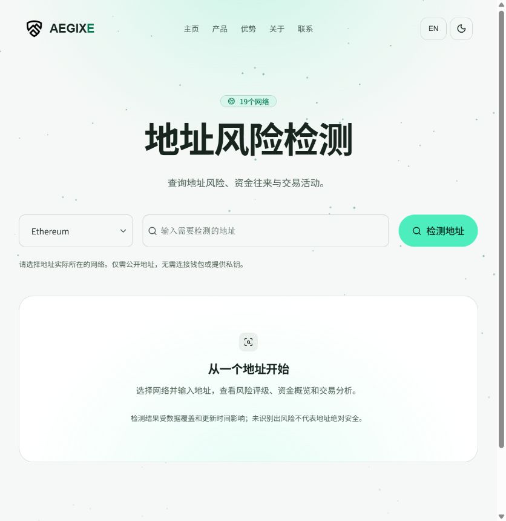

# 地址风险检测操作指南

[English](wallet-address-risk.md) · [打开工具](https://risk.aegixe.com/) · [返回目录](../README.zh-CN.md)

适用页面：AEGIXE 地址风险检测中文网页版。操作核对日期：2026-11-12。

## 1. 准备地址和网络

准备要核查的完整公开地址，并确认其实际所在网络。付款方地址、代币合约地址及交易所共用地址代表不同对象，不能互相替代。工具只需要公开地址，无需连接钱包或提供私钥。

## 2. 发起检测

1. 打开工具，在“区块链网络”中选择地址所在网络。页面当前标注 19 个网络；具体以选择列表为准，不能据此认为所有网络的数据覆盖相同。
2. 在“钱包地址”输入框粘贴完整地址，核对开头、结尾和中间字符，去掉多余空格。
3. 点击“检测地址”。界面显示“正在检测…”时等待处理结束，避免重复提交。
4. 出现“地址检测结果已更新”后，先核对结果中的网络、完整地址及检测时间，再读风险信息。时间以页面标注的北京时间为准。

## 3. 按模块阅读结果

| 模块 | 阅读方法 |
| --- | --- |
| 风险摘要 | 对照风险等级、原始等级、评分和地址标签阅读。不要自行推导评分阈值或将分数换算为违法概率。 |
| 当前余额、交易总笔数、累计转入/转出 | 同时检查数值、获取状态和数据时间。未提供不等于零。 |
| 风险来源与暴露明细 | 图表仅展示已提供金额的部分条目。点击“展开明细（数量）”查看实体、风险类型、暴露类型、关联跳数、金额和占比。可按可用列排序，存在多页时翻页。 |
| 交易行为分布 | 对照转入、转出及类别；未提供数量不计为零。 |
| 主要交易对手 | 只表示已识别的往来实体，不代表完整交易历史。 |
| 活动时间 | 核对数据时间与覆盖范围，不能仅凭最近活动判断身份或资金来源。 |

各项数据可能分别成功、失败或不受支持。风险暴露可能包含直接或间接关联，各项可能重叠，不能简单相加推断总风险；“直接关联”也不能单独证明主观意图或违法行为。

## 4. 常见情况

- **“上游分析超时，请稍后重试”／“获取失败”**：本次实测曾出现。将受影响字段记为未知，稍后重试；其他模块返回结果不代表这些字段已经成功。
- **“当前地址或网络暂不支持”**：属于覆盖限制，不能写成未发现风险。
- **标签、金额或对象难以解释**：先确认是否查了代币合约而非付款钱包，再结合交易记录和可靠来源核对；保留待核实状态，不直接转述为事实。
- **没有风险提示**：只代表本次数据与覆盖范围内未识别相关信号，不能保证发行方未限制该地址或交易所必然入账。

## 5. 保存自己的核查记录

在适当的内部系统记录网络、完整地址、查询时间、字段状态、提示原文和待核实事项。可选用[空白记录模板](../templates/README.md)。不要把私人支付资料提交到公开 GitHub。

本指南经网页操作核对；标签归因与数据准确性未完成独立技术复核。检测结果仅反映检测时点，涉及重要交易时应进一步核实。[USDT 收款核查参考](usdt-payment-risk.zh-CN.md) · [联系 AEGIXE](https://aegixe.com/contact-us-form/)
